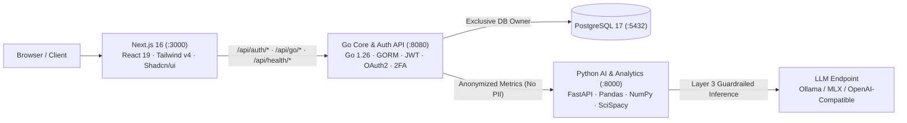

# NutriSync

**A privacy-first AI Health & Wellness tracking and analytics platform** built on a polyglot 3-service architecture (**Next.js 16**, **Go 1.26**, and **Python FastAPI**).

NutriSync tracks weight, BMI, physical activity, and daily habits, computes deterministic wellness scores and milestones, and generates personalized, clinically guardrailed AI insights—without ever exposing user PII to the AI layer.

---

## Why This Project Stands Out

- **Polyglot Microservice Architecture ([ADR-0002](./docs/adr/0002-single-db-ownership-go-gorm.md)):** Clean separation of concerns across a Next.js frontend/BFF, a Go core/auth API, and a stateless Python analytics & AI service. PostgreSQL is owned exclusively by the Go service via GORM—neither Next.js nor Python connects to the database directly.
- **Privacy-First Two-Tier PII Anonymization ([ADR-0003](./docs/adr/0003-two-tier-pii-and-3-layer-ai.md)):** The Go backend strips all personally identifiable information (names, emails, raw IDs) before calling Python. Layer 1 in Python performs an additional SciSpacy-based PII scrub and clinical constraint extraction.
- **3-Layer Guardrailed AI Pipeline + Deterministic Fallback:**
  1. **Layer 1 (`layer1_scispacy_extractor.py`):** Extracts dietary/medical constraints and scrubs residual PII.
  2. **Layer 2 (`layer2_prompt_constructor.py`):** Builds structured, context-compacted prompts from historical trends.
  3. **Layer 3 (`layer3_llama_validator.py`):** Calls a fine-tuned LLM (`nutrisync-llama` via Ollama/MLX or any OpenAI-compatible API), validates the JSON schema with Pydantic, sanitizes forbidden clinical terms, and **automatically falls back to a deterministic clinical insight engine** if the LLM is unavailable.
- **Custom QLoRA / LoRA Fine-Tuning:** Includes a full fine-tuning and evaluation pipeline ([`services/py-ai/training/`](./services/py-ai/training/README.md)) for Llama 3.2 1B (`nutrisync-llama`).
- **Production-Grade Auth & GDPR Controls:** JWT with refresh-token rotation, Google & GitHub OAuth2, TOTP Two-Factor Authentication (2FA), email verification, password reset, and user consent/account management.

---

## System Architecture



---

## Key Features

- **Health Profile & Habit Tracking:** Track weight history, height, target goals, activity logs, and daily wellness habits.
- **Deterministic Wellness Score Engine:** Transparent weighted scoring (`0.3 × BMI + 0.3 × Activity + 0.2 × Progress + 0.2 × Habits`) with historical trend compaction and milestone projections.
- **AI-Powered Insights with Clinical Guardrails:** Actionable nutrition and fitness recommendations constrained by user-declared health conditions, validated against strict schemas and safety filters.
- **Full Authentication Suite:** Email/password registration with verification, Google & GitHub OAuth2, TOTP 2FA setup/verification, and secure password reset flows.

---

## Tech Stack

| Layer | Technologies |
| :--- | :--- |
| **Frontend** | Next.js 16.4 (App Router, Turbopack), React 19.3, TypeScript 5, Tailwind CSS v4, Shadcn/ui, React Hook Form, Zod v4 |
| **Core Backend & Auth** | Go 1.26 (`net/http`), GORM, PostgreSQL 17, JWT + Refresh Token Rotation, Google/GitHub OAuth2, TOTP 2FA, SMTP |
| **Analytics & AI** | Python 3.12, FastAPI, Uvicorn, Pydantic v2, Pandas, NumPy, SciSpacy, QLoRA/LoRA (`mlx_lm` / Ollama / OpenAI-compatible) |
| **Testing & Tooling** | Vitest, Playwright (E2E), `go test` / `go vet`, `pytest`, Docker Compose, `pnpm` |

---

## Repository Structure

```text
.
├── app/                    # Next.js App Router pages (dashboard, profile, auth flows)
├── components/             # Reusable UI & Shadcn components
├── services/
│   ├── go-api/             # Go Core & Auth API (handlers, models, repositories, GORM)
│   └── py-ai/              # Python FastAPI service (analytics, 3-layer AI pipeline, QLoRA training)
├── docs/
│   ├── adr/                # Architecture Decision Records (ADR-0001 to ADR-0003)
│   └── specs/              # Feature & API specifications
├── e2e/                    # Playwright end-to-end test suite
├── scripts/                # One-command Docker & local dev launch scripts
├── compose.yaml            # Full 4-container orchestration (Next.js, Go, Python, Postgres)
└── Dockerfile              # Multi-stage standalone Next.js production build
```

---

## Quick Start

### 1. Configure Environment
```bash
cp .env.example .env
```
Update `JWT_SECRET` (and optionally OAuth/SMTP/LLM variables) in `.env`.

### 2. Run with Docker Compose (Recommended)
Starts **PostgreSQL (`:5432`)**, **Go API (`:8080`)**, **Python AI (`:8000`)**, and **Next.js (`:3000`)**:
```bash
./scripts/start-docker.sh
```
*(Or manually via `docker compose up --build`.)*

- **Web App:** http://localhost:3000
- **Go API Health:** http://localhost:8080/health
- **Python AI Health:** http://localhost:8000/health

> **Note on LLM:** If a local Ollama/MLX server or cloud LLM API key is not configured, NutriSync still runs 100% end-to-end using Layer 3's deterministic clinical fallback.

### 3. Run in Local Development (Hot-Reload)
Runs PostgreSQL in Docker and launches Python, Go, and Next.js natively:
```bash
./scripts/start-local-dev.sh
```
Optional flags: `--llm=mlx`, `--llm=ollama`, `--llm=fallback`, `--stop-db`.

---

## Verification & Documentation

| Area | Command / Location |
| :--- | :--- |
| **Frontend (TypeScript + ESLint + Vitest)** | `./.agents/skills/create-nextjs-feature/scripts/verify-frontend.sh` |
| **Frontend E2E (Playwright)** | `pnpm test:e2e` |
| **Go Core API (`gofmt` + `go vet` + `go test`)** | `./.agents/skills/create-go-endpoint/scripts/verify-go-endpoint.sh` |
| **Python AI (`pytest` + Stateless DB Audit)** | `./.agents/skills/build-py-ai-pipeline/scripts/verify-py-ai.sh` |
| **Architecture Decision Records** | [`docs/adr/README.md`](./docs/adr/README.md) |
| **QLoRA Fine-Tuning & Evaluation** | [`services/py-ai/training/README.md`](./services/py-ai/training/README.md) |
